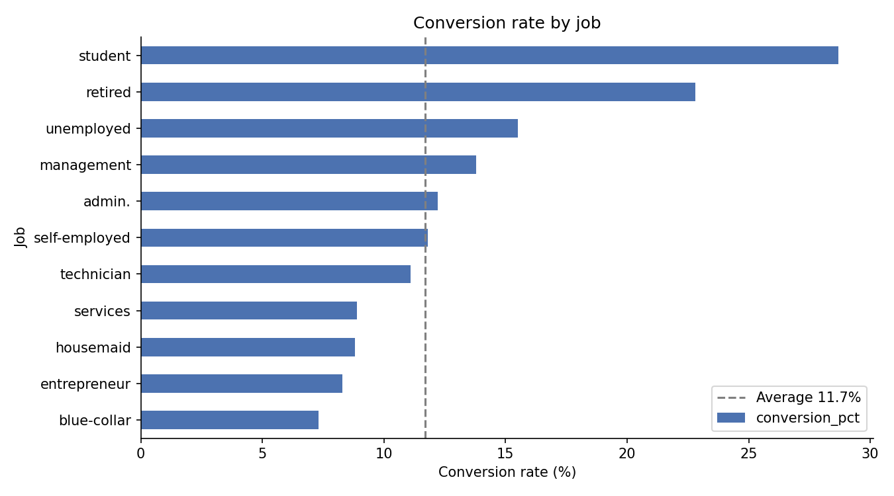
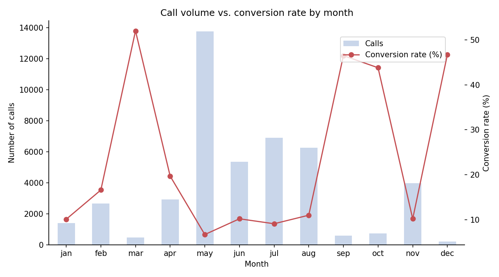

# Bank Marketing Campaign Analysis

Which customers are most likely to subscribe to a term deposit, and how can a bank make its phone campaigns more efficient?

This project analyzes 45,211 marketing calls from a Portuguese bank using **Python (pandas, matplotlib)** and **SQL (SQLite)**.

## Key findings

- Overall conversion rate: **11.7%** (5,289 subscriptions from 45,211 calls).
- Customers who said yes in a previous campaign converted at **64.7%**, about **5.5x** the average, but made up only 3% of calls.
- **Students (28.7%)** and **retirees (22.8%)** converted best by job; blue-collar workers converted least (7.3%). By age, customers **65+ (42.1%)** and **18-24 (25.6%)** converted best.
- **May** was the busiest month (30% of all calls) but had the **lowest conversion rate (6.7%)**. March, September, October and December converted above 40%, on much smaller volumes.
- Conversion fell from **14.6%** for customers called once to **6.5%** for those called 6-10 times, and **3.9%** for 11+ calls.

## What I did

1. **Data quality checks:** types, missing values, duplicates, and "unknown" placeholder values.
2. **Cleaning:** converted the target to 1/0, flagged customers never contacted before (`pdays = -1`), grouped ages into bands, and ordered months.
3. **SQL analysis:** loaded the cleaned data into SQLite and wrote `GROUP BY` / `HAVING` queries for conversion by job, previous outcome and contact channel.
4. **pandas analysis:** conversion by age group, month and number of calls.
5. **Visualization:** charts comparing each segment with the overall average.
6. **Recommendations** for targeting, timing and call limits.

Call duration was left out of the targeting analysis because it is only known after a call ends, so it cannot help decide whom to call.

## How to run

1. Download the data from the [UCI Machine Learning Repository](https://archive.ics.uci.edu/dataset/222/bank+marketing). Unzip it, then unzip `bank.zip` inside it, and put `bank-full.csv` in the `data/` folder.
2. Install the packages: `pip install -r requirements.txt`
3. Open `bank_marketing_analysis.ipynb` in Jupyter (or upload it with the CSV to Google Colab) and run all cells. Charts are saved to `images/`.

## Data source

Moro, S., Rita, P., & Cortez, P. (2014). Bank Marketing [Dataset]. UCI Machine Learning Repository. Licensed under CC BY 4.0.
